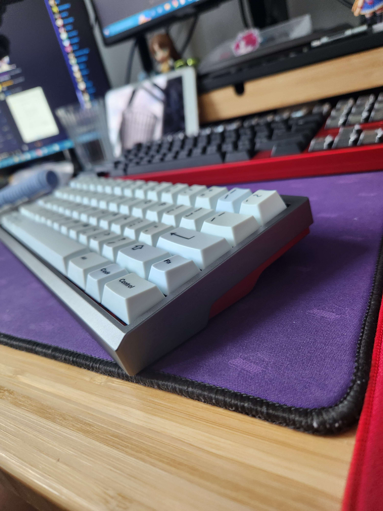
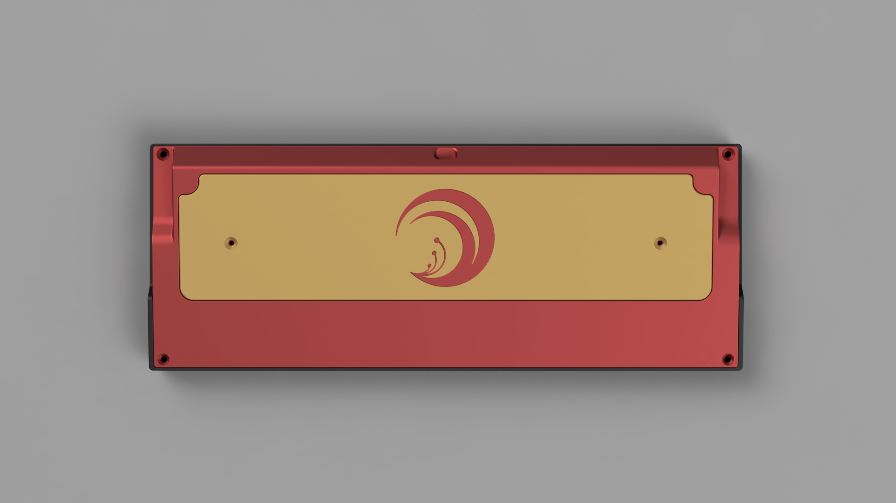
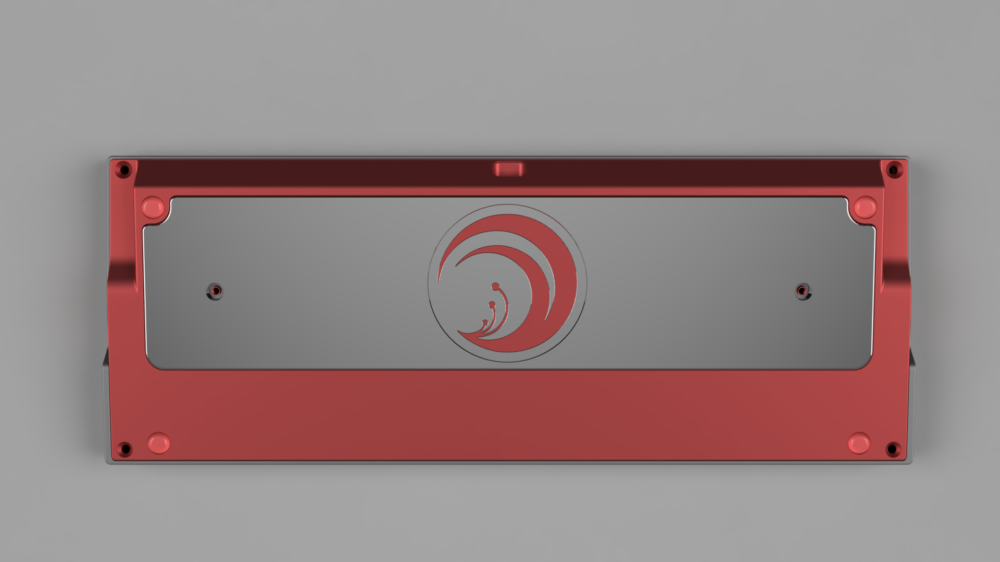
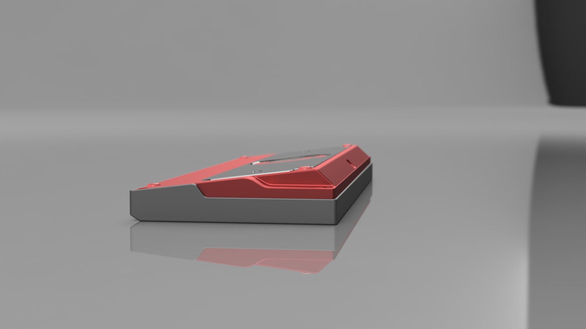
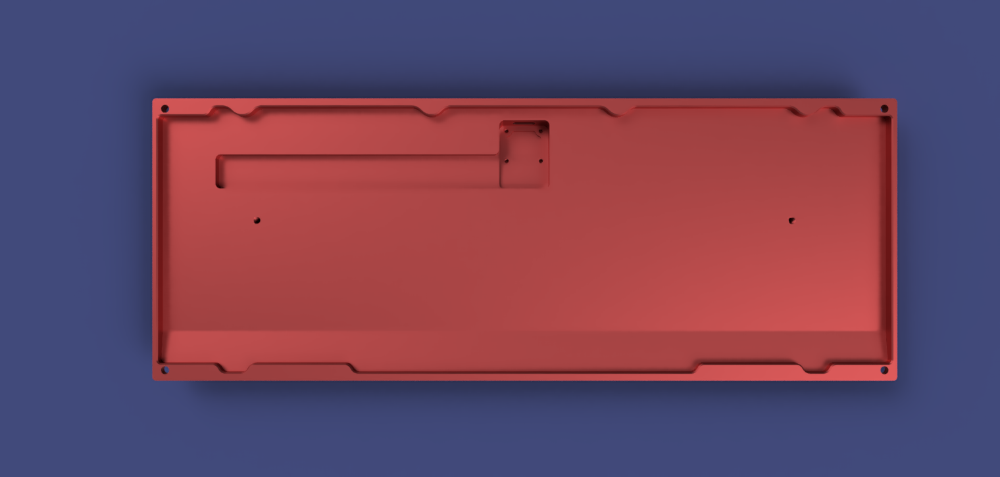
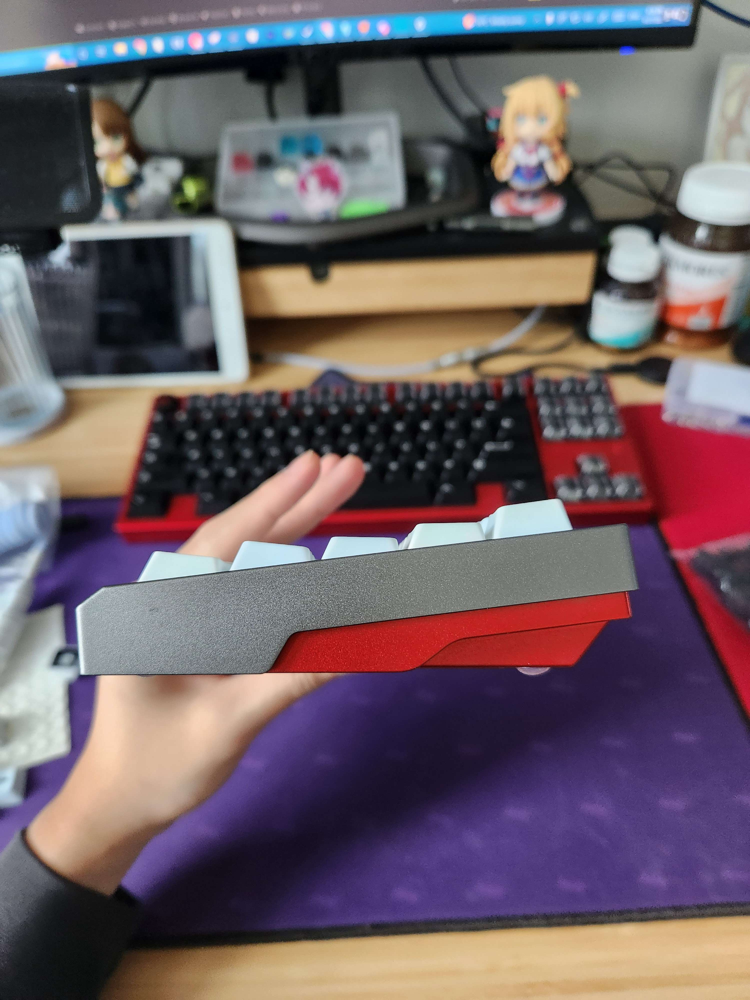
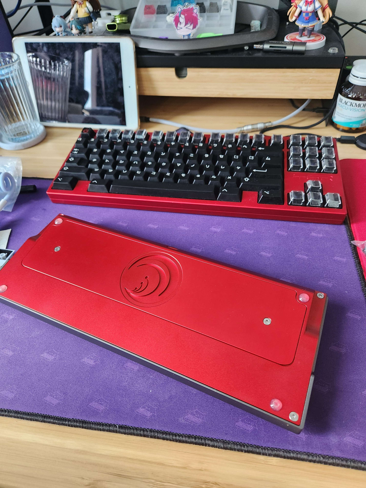

# 🌺 LYCORIS60

> *"A one-off 60% CNC-machined aluminium keyboard, inspired by* ***Lycoris Recoil***."

<p align="center">
  
</p>

---

## ⚙️ Specs

| | |
|---|---|
| **Form factor** | 60% (standard size) |
| **Type** | One-off — a single board, not for sale |
| **Case** | CNC-machined 6061 aluminium, anodized |
| **Colorway** | Chisato Edition — silver top / red bottom |
| **Editions** | Chisato (red, built) & Takina (blue, render only) |
| **PCB** | Standard 60% with daughterboard support |
| **Emblem** | Engraved spider lily (from *Lycoris Recoil*) |
| **Sound profile** | No foam |
| **Sourced from** | Alibaba supplier (China) |

---

## 🔧 Development

- **CAD / modeling:** 3D modeling (Fusion 360)
- **Renders:** Blender

---

## 🌺 The Design

The design is a love letter to *Lycoris Recoil*. The case is a two-tone anodized aluminium build with a sharp angular notch along the sides, and the **spider lily** emblem from the anime engraved into the bottom plate.

The design was modeled in 3D and rendered in May 2023. Two editions were explored — one for each of the two agents:

### 🌊 Takina Edition — *navy / gold*

<p align="center">
  
</p>

<details>
<summary>Top view</summary>
<p align="center"></p>
</details>

<details>
<summary>Bottom view</summary>
<p align="center"></p>
</details>

<details>
<summary>Side view</summary>
<p align="center"></p>
</details>

### 🌺 Chisato Edition — *silver top / red bottom*

The Chisato Edition is the one that was actually built. The renders also explore a gold anodizing variant that was considered.

<p align="center">
  
</p>

<details>
<summary>Side profile</summary>
<p align="center"></p>
</details>

<details>
<summary>Side profile 2</summary>
<p align="center"></p>
</details>

<details>
<summary>Side profile 3</summary>
<p align="center"></p>
</details>

<details>
<summary>Gold back view</summary>
<p align="center"></p>
</details>

<details>
<summary>Gold back view 2</summary>
<p align="center"></p>
</details>

<details>
<summary>Polished weight back view</summary>
<p align="center"></p>
</details>

<details>
<summary>Polished weight back view 2</summary>
<p align="center"></p>
</details>

<details>
<summary>Polished weight back view 3</summary>
<p align="center"></p>
</details>

<details>
<summary>Polished weight back view 4</summary>
<p align="center"></p>
</details>

<details>
<summary>Back side angle</summary>
<p align="center"></p>
</details>

<details>
<summary>Side profile</summary>
<p align="center"></p>
</details>

<details>
<summary>Side profile</summary>
<p align="center"></p>
</details>

#### 🔍 Emblem & Weight Close-ups

<details>
<summary>Gold weight close-up</summary>
<p align="center"></p>
</details>

<details>
<summary>Polished weight close-up</summary>
<p align="center"></p>
</details>

<details>
<summary>No weight close-up</summary>
<p align="center"></p>
</details>

#### 🔧 Interior Views

<details>
<summary>Inside top frame</summary>
<p align="center"></p>
</details>

<details>
<summary>Inside bottom case</summary>
<p align="center"></p>
</details>

---

## 🔨 The Build

- **May 2023** — designed and rendered the case in 3D. Early on, the colorway came out reversed in the renders (silver/red flipped) — caught and corrected before sending to the supplier.
- **September 9, 2023** — decided the back would carry an engraved waifu... then settled on the spider lily emblem instead.
- **September 27, 2023** — the prototype arrived. Assembled and soundtested with **MX Browns + GMK Bleached** keycaps, no foam.
- **September 28, 2023** — streamed the unboxing and soundtest.

### Soundtest

> Recorded with MX Browns + GMK Bleached, no foam.

[▶️ Listen to the soundtest (mp3)](audio/lycoris60.mp3)

---

## 📷 The Result — *Chisato Edition*

<p align="center">
  
</p>

<p align="center">
  
</p>

<p align="center">
  
</p>

---

## 📁 Repository Structure

```
lycoris60/
├── README.md
├── audio/
│   └── lycoris60.mp3        # Soundtest (MX Browns + GMK Bleached, no foam)
└── images/
    └── design/
        ├── takina/          # Takina Edition renders (navy / gold)
        ├── chisato/         # Chisato Edition renders (silver / red, built)
        ├── chisato-final/   # Photos of the finished Chisato Edition board (Sep 2023)
        ├── emblem-weight/   # Emblem & weight close-ups
        └── interior/        # Interior views
```

---

*Built by [ReinTanto](https://github.com/ReinTanto). A one-off — no group buy, no for-sale.* 🌺
